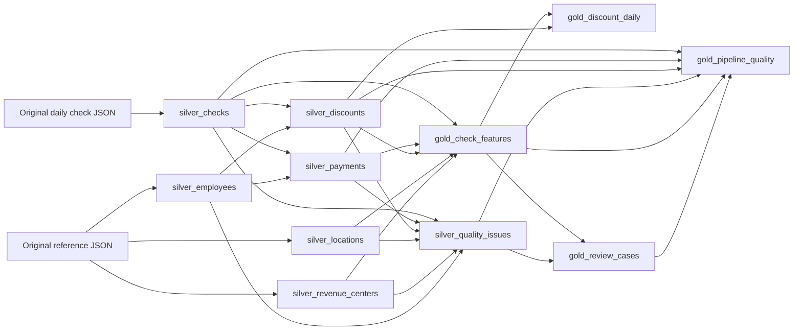

# Carta Azul pipeline architecture

The implemented pipeline turns the closed Applebee's transaction history into reusable check, discount, payment, quality and review datasets. It publishes **11 materialized views in `workspace.applebees`**. A check is the source transaction/ticket; employee identifiers describe operational roles and do not establish who received a benefit.

The accepted historical runs processed 115 daily files covering **2026-04-28 through 2026-08-20**, with 2,142,846 checks. The [operating guide](README.md) records the successful runs, tests and access-controlled evidence.

## Sources and orchestration

The preserved source root is `/Volumes/workspace/applebees/raw_files/data/Dataset`:

| Source | Use |
| --- | --- |
| `facts/checks/brand=rmh/dt=YYYY-MM-DD/checks.json` | Checks containing nested items, ticket discounts, item discounts, payments, taxes and voids. The configuration selects an inclusive date range explicitly. |
| `dimensions/locations/*.json` | Location labels and source time-zone context. |
| `dimensions/revenue_centers/*.json` | Revenue-center/channel labels. |
| `dimensions/employees/*.json` | Minimal historical references for actors and approvers. |

The JSON files remain the authoritative originals. The first managed tabular materialization is `silver_checks`; the source volume is not described as a Bronze Delta table. Item, tax and void arrays stay in that base, where their required totals are calculated without expanding separate physical detail tables.

The [Job definition](../jobs/carta_azul_job.yml) contains one `historical_pipeline` task invoking the [Lakeflow pipeline definition](carta_azul_pipeline.yml). The Job runs manually, allows one concurrent run, queues subsequent runs, allows one retry and has a four-hour timeout. Lakeflow infers the dataset dependencies from their reads; a separate Job task for every view is unnecessary. The runtime is serverless, triggered, ADVANCED, on the current channel.

## Dataset dependency graph

Solid arrows represent data dependencies. The Job invokes this graph as one pipeline update; source-file order does not determine transformation order.



`gold_discount_daily` is an independent output branch. A quality row alone does not certify that every other branch completed: consumers require a successful overall Job/pipeline update as well as acceptable quality results.

## Table contracts

`K` denotes the SHA-256 ticket key derived from the structured combination of `brand`, source `partition_date`, `location_id` and `check_id`. The following counts are the accepted historical snapshot, not assumptions for arbitrary future inputs.

| Materialized view | Grain and purpose | Accepted rows |
| --- | --- | ---: |
| `silver_checks` | One canonical inspection row per source check key. Retains arrays, source values, totals, duplicate counts and eligibility flags. Invalid source keys receive a provenance-based identity and remain analytically ineligible. | 2,142,846 |
| `silver_locations` | One canonical location ID reference, with name, time zone, original open/close dates and reference-quality flags. | 185 |
| `silver_revenue_centers` | One canonical revenue-center ID reference, supplying channel labels and reference-quality flags. | 23 |
| `silver_employees` | One canonical employee ID reference, retaining location IDs and historical `Deleted`/`Borrowed` context while excluding personal names, birth dates and payroll identifiers. | 156,975 |
| `silver_payments` | `K + payment_position`: one original payment event, signed amount, raw/normalized gratuity, category, tender flags and actor-reference status. | 2,232,092 |
| `silver_discounts` | `K + scope + item_position + discount_position`: one ticket- or item-level discount event, label, amount, actor and approver context. Ticket-level events use item position `-1`. | 516,690 |
| `silver_quality_issues` | One observation per canonical entity and failing rule, with severity, explanation, affected source-row count and provenance. | 30,232 |
| `gold_check_features` | One row per canonical check. Combines independent event summaries with location/channel context, financial features and comparison eligibility. | 2,142,846 |
| `gold_discount_daily` | Brand, business date, location, channel, discount ID, label and employee-label flag. Publishes amounts and distinct-check frequencies with explicit population denominators. | 155,887 |
| `gold_review_cases` | One check and reason, identified by a hash of `ticket_key + reason_code`. Separates data-quality follow-up from exploratory peer comparisons. | 16,033 |
| `gold_pipeline_quality` | One current-snapshot record of coverage, counts, references, reconciliation, review populations and configured rule parameters. | 1 |

Repeated business/reference keys are selected deterministically for inspection, with the repeated-source count preserved. Conflicting records are not silently accepted as clean: repeated check keys are excluded from analytical eligibility, and repeated reference keys do not resolve actors or comparison context.

Definitions live in [Silver transformations](../../src/transformations/silver/) and [Gold transformations](../../src/transformations/gold/). The reference source file defines three views; nine transformation entry files plus two imported helper modules produce the eleven views.

## Transformations and financial definitions

Payments and discounts expand independently using array positions. Item discounts use a second expansion within each item; items and payments are never exploded together. Gold joins one-per-check event aggregates, preventing a Cartesian multiplication of money. The quality snapshot checks event counts against array lengths in the canonical check base.

Numeric amounts use `DECIMAL(18,4)`. Item and void quantities support fractions. Required null fields or unknown arrays are distinguished from empty arrays through completeness flags; zero-based display totals do not make incomplete data analytically eligible.

```text
gross_sales       = sum(ItemsSold.GrossPrice)
sold_sales        = sum(ItemsSold.SoldPrice)
net_sales         = sold_sales - sum(ticket Discounts.Amount)
item_discounts    = sum(ItemsSold.Discounts.Amount)
total_discounts   = item_discounts + sum(ticket Discounts.Amount)
tip               = -sum(Payments.Gratuity)
actual_settlement = sum(Payments.Amount) + sum(Payments.Gratuity)
expected_settlement = net_sales + sum(Tax.Amount) + ServiceCharge
settlement_difference = actual_settlement - expected_settlement
item_discount_difference = gross_sales - sold_sales - item_discounts
```

`SoldPrice` already reflects item discounts in the observed data; subtracting them again would understate net sales. Prices are recorded line amounts and are not multiplied by `Quantity`. Reconciliation uses an empirical absolute tolerance of 0.05, rather than claiming an official accounting policy. Original negative payments, including `GC Sold`, and original gratuity signs remain available.

`BusinessDate` is parsed as a date and compared with the source date partition. Original open/close strings and location time-zone context are retained; the pipeline does not claim to convert them into verified UTC event timestamps.

Employee-discount classification detects trimmed, uppercased labels beginning with `EMP` followed by whitespace or the end of the label. It is descriptive, not a benefit policy. Unknown discount labels/IDs or payment-card/category context prevent ordinary cohort membership. Gross/net tip ratios require positive denominators and monetary eligibility. Daily population denominators repeat for each discount label and must not be added across labels.

## Quality, provenance and privacy

Explicit schemas and `FAILFAST` reject incompatible JSON parsing. Warning expectations preserve source observations and emit metrics. `silver_quality_issues` provides the explained issue records; it is implemented explicitly rather than being an automatic quarantine feature. Structural expectations in Gold fail updates for missing historical coverage, empty input, changed check cardinality or lost/extra child events. See [Engineering decisions](ENGINEERING_DECISIONS.md) for the distinction between issue severity and expectation action.

Traceability includes the original `source_file`, source date partition, business identifiers and event positions. `source_record_hash` fingerprints the declared parsed fields; it is not a byte-level checksum of the entire original JSON document. Rule versions and analytical definitions accompany outputs. Employee-reference joins use unique, nonzero `employees.Id`; `ManagerId = 0` remains unresolved, and historical `Deleted` records are retained.

Raw data, identifiers and detailed private outputs remain under authorized workspace/volume access. Only source code, configuration, sanitized notebooks and documentation belong in Git. Review cases are explanations for human investigation, with cohort support and thresholds, and are never fraud labels. After any failed update, inspect the overall run before consuming outputs: the graph is not a global transaction that rolls back every table together.
